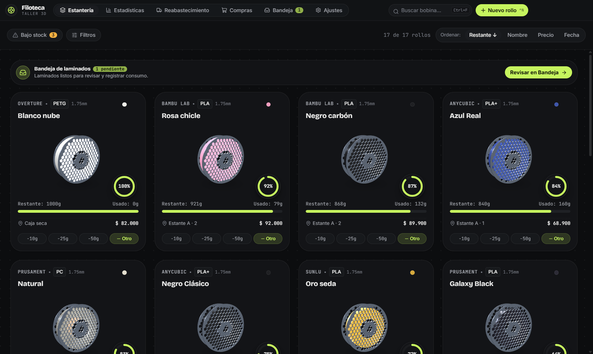
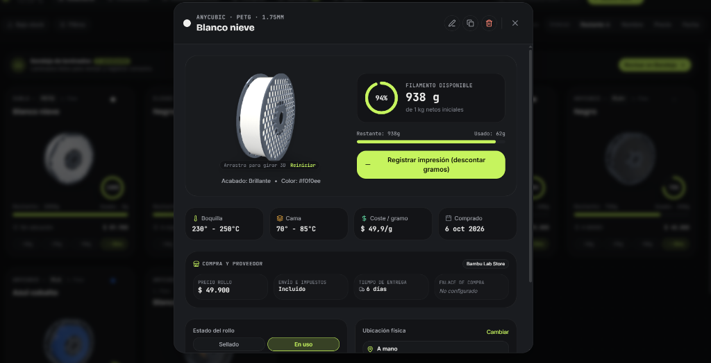
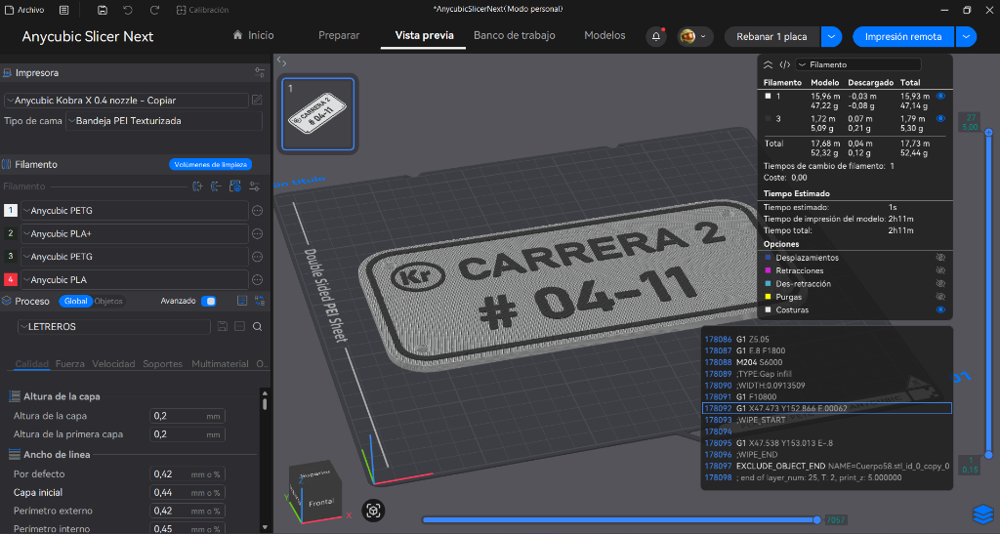
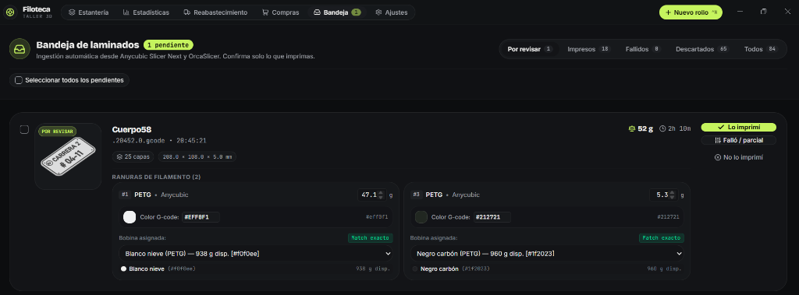
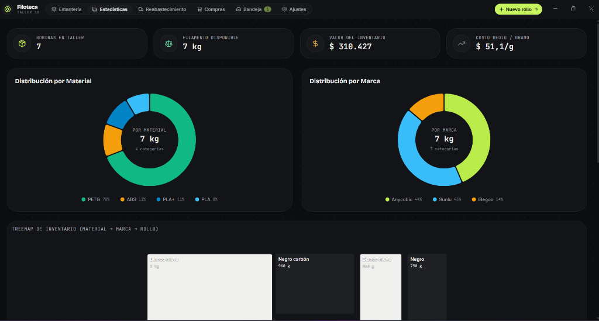
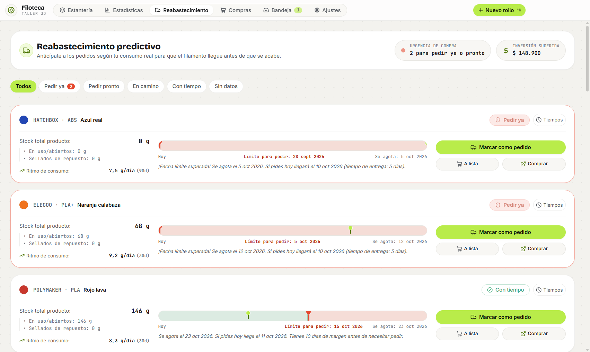
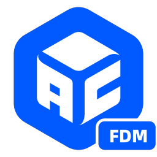
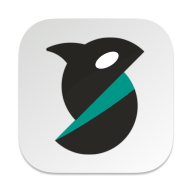

<h1 align="center">Filoteca 🧵</h1>

<p align="center">
  <b>Inventario de Filamento para Impresión 3D — Visual, Inteligente y 100% Offline</b>
</p>

<p align="center">
  <a href="README.md">🇺🇸 Read in English</a> · <a href="#">🇨🇴 Español</a>
</p>

<p align="center">
  
  
  
  
</p>

> Desarrollado por **TermuxX solutions** — Una aplicación de escritorio moderna que transforma las típicas hojas de cálculo de filamento en una estantería 3D interactiva para tu taller. Gestiona tus bobinas visualmente, controla el consumo en tiempo real, recibe alertas de reabastecimiento y sincroniza automáticamente con tu laminador.

---

## 🧵 Gestión de Bobinas y Visualización 3D

Cada bobina de tu inventario se renderiza como un **modelo 3D realista** que refleja su color real, el acabado del material y el nivel de filamento restante. No más adivinanzas — solo mírala.



- **Nivel de Filamento en Tiempo Real** — La bobina 3D se reduce proporcionalmente al peso restante. Una bobina al 30% se ve como una bobina al 30%.
- **Acabados de Material Auténticos** — Cada bobina se renderiza con su acabado real: mate, brillante, seda (brillo nacarado), translúcido o glitter.
- **Inspección Interactiva 360°** — Haz clic en cualquier bobina para abrirla en vista detallada, donde puedes girarla y examinarla desde cualquier ángulo con inercia suave.
- **Detalles Completos de Bobina** — Temperaturas, costo por gramo, proveedor, ubicación física en el taller, fecha de compra y notas — todo de un vistazo.



---

## 🤖 Detección Automática del Laminador

Filoteca vigila la carpeta temporal de tu laminador en segundo plano. En el momento en que laminas un modelo, aparece automáticamente en la **Bandeja Companion** de Filoteca — sin exportar archivos, sin arrastrar y soltar, sin buscar carpetas.



- **Detección Instantánea en Segundo Plano** — Lamina tu modelo y Filoteca lo captura silenciosamente. Una insignia sutil `Bandeja (1)` se enciende en la barra de título.
- **Emparejamiento Automático de Color** — Cada ranura de color se empareja automáticamente con la mejor bobina de tu inventario según similitud de color, marca y tipo de material.
- **Soporte Multicolor Completo** — Compatibilidad total con configuraciones multimaterial (Anycubic ACE Pro / Serie Kobra) con seguimiento de peso por ranura.
- **Tú Decides Qué Cuenta** — Nada se descuenta sin tu confirmación:
  - ✅ **"Lo imprimí"** — Descuenta los gramos exactos de tu stock.
  - ⚠️ **"Falló / Parcial"** — Ajusta el porcentaje realmente utilizado.
  - ❌ **"No lo imprimí / Descartar"** — Sin descuento, trabajo archivado.



---

## 📊 Estadísticas del Taller

Un panel de analíticas integrado te ofrece una vista panorámica de todo tu inventario con gráficos interactivos e indicadores clave de rendimiento.



- **Distribución por Material** — Visualiza cómo se compone tu inventario por tipo de filamento (PLA, PETG, ABS, TPU, etc.) con gráficos de dona interactivos.
- **Panorama de Marcas** — Controla qué marcas dominan tu estantería y compara el valor del inventario entre proveedores.
- **KPIs del Taller** — Total de bobinas, peso total en stock, valor total del inventario (en tu moneda local) y costo promedio por gramo.

---

## 🛡️ Inventario Inteligente y Alertas de Reabastecimiento

No te quedes sin filamento a mitad de una impresión. Filoteca monitorea tus patrones de consumo y te avisa antes de que sea tarde.



- **Previsión de Consumo** — Rastrea tu uso de los últimos 30 días por bobina y estima cuándo se agotará.
- **Alertas Semáforo** — 🔴 Crítico (pide ya), 🟡 Próximo (planifica), 🟢 Listo (todo bien).
- **Detección de Bobinas de Respaldo** — ¿Ya tienes un rollo sellado de repuesto? Filoteca lo detecta y ajusta la urgencia.
- **Lista de Compras en Un Clic** — Añade bobinas con bajo stock directamente a tu lista de suministros.

---

## 🖨️ Compatibilidad con Laminadores

<table>
  <tr>
    <td align="center" width="50%">
      
      <br /><br />
      <b>Anycubic Slicer Next Gen</b>
      <br />
      <code>✅ Integración Nativa Activa</code>
      <p>Detección automática de piezas laminadas, ranuras multicolor, vistas previas de placa y estimaciones de material.</p>
    </td>
    <td align="center" width="50%">
      
      <br /><br />
      <b>OrcaSlicer</b>
      <br />
      <code>🚀 Próximamente</code>
      <p>La compatibilidad nativa con OrcaSlicer está actualmente en desarrollo activo y estará disponible en una próxima actualización.</p>
    </td>
  </tr>
</table>

---

## 🌍 Multi-Idioma, Moneda Local y Temas

- **3 Idiomas Integrados** — Español 🇨🇴, English 🇺🇸 y Português 🇧🇷.
- **Soporte de Moneda Local** — COP (\$), USD (\$), EUR (€), BRL (R\$) y más.
- **Modo Oscuro y Claro** — Estética pulida de taller maker diseñada para tu estudio.

---

## 🔒 100% Offline y Privado

Tus datos nunca salen de tu computador. Sin cuentas, sin nube, sin internet, sin suscripciones. Todos los datos de bobinas, precios e historial se guardan localmente en tu PC.

---

## 🚀 Descarga Rápida (Sin Instalación)

1. Ve a **[Releases](https://github.com/Mate1592/FILOTEK_ANYCUBIC/releases)**.
2. Descarga **`Filoteca-Portable-1.0.1.exe`**.
3. Doble clic para iniciar — funciona desde tu escritorio o una memoria USB.

*(También hay disponible un instalador clásico `Filoteca Setup 1.0.1.exe` si prefieres accesos directos en el Menú Inicio).*

---

## 👥 Comunidad y Participación

- **Dudas, ideas y fotos de talleres:** [GitHub Discussions](https://github.com/Mate1592/FILOTEK_ANYCUBIC/discussions)
- **Reporte de errores o sugerencias:** [GitHub Issues](https://github.com/Mate1592/FILOTEK_ANYCUBIC/issues)

---

## ☕ Apoyo y Donaciones

Filoteca es un proyecto de código abierto creado por **TermuxX solutions** para la comunidad maker y de impresión 3D de todo el mundo. Si te ahorra tiempo y filamento en tu taller, apoya su desarrollo continuo:

### Colombia 🇨🇴 (Pagos Locales)
- **Wompi / PSE / Nequi / Bancolombia / Tarjetas:**
  👉 [checkout.wompi.co/l/miKi8F](https://checkout.wompi.co/l/miKi8F)

### Global 🌎 (Pagos Internacionales)
- **PayPal:**
  👉 [paypal.me/matec15](https://paypal.me/matec15)

---

## 🛠️ Desarrollo y Compilación Local

```powershell
# 1. Instalar dependencias
npm install

# 2. Iniciar en modo desarrollo
npm run dev

# 3. Compilar versión portable (.exe)
npm run dist:portable
```

---

## 📄 Licencia

Distribuido bajo la Licencia MIT. Consulta [`LICENSE`](LICENSE) para más detalles.

---

<p align="center">Desarrollado con dedicación por <b>TermuxX solutions</b> para la comunidad maker global.</p>
