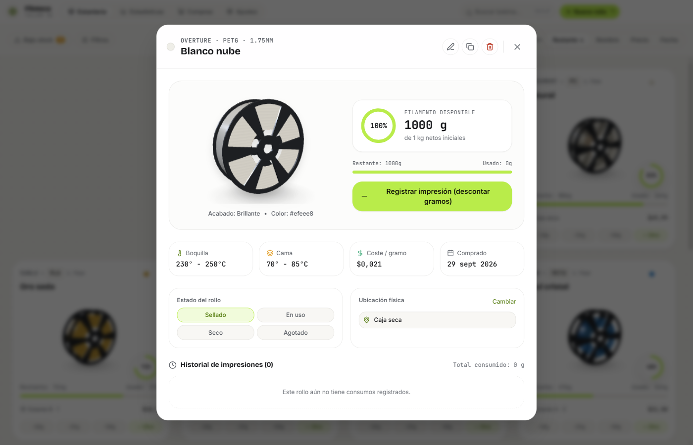
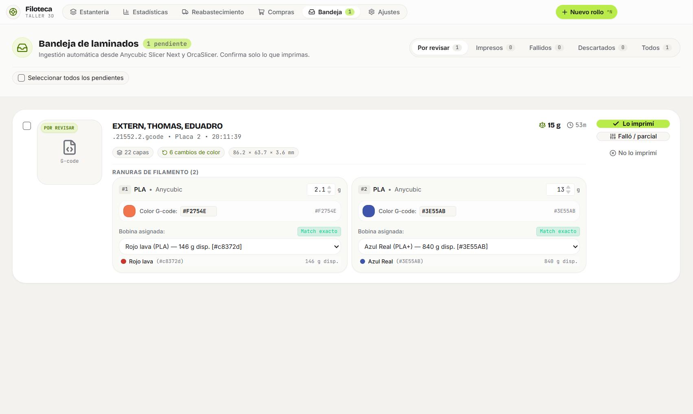

# Filoteca 🧵

[🇪🇸 Leer en Español](README.es.md) | [🇺🇸 English]


> **3D Printing Filament Inventory** — Developed by **TermuxX solutions**. A modern, visual, and 100% offline desktop application for Windows. Manage your workshop spools in interactive 3D, track filament levels visually, get smart restock alerts, and connect seamlessly with Anycubic Slicer Next Gen.

Filoteca turns boring inventory spreadsheets into an interactive 3D workshop shelf. Inspect your spools in real-time 3D, admire realistic material finishes (silk, matte, glossy, translucent, glitter), and never run out of filament in the middle of a print job again.

---

## 📸 Visual Showcase

### Interactive 3D Spool Shelf


### 360° Spool Inspection & Details


### Smart Replenishment & Consumption Forecast


---

## 🖨️ Slicer Compatibility

<table>
  <tr>
    <td align="center" width="50%">
      
      <br /><br />
      <b>Anycubic Slicer Next Gen</b>
      <br />
      <code>✅ Native Support Active</code>
      <p>Automatic detection of sliced projects, multi-color slots (Anycubic ACE Pro / Kobra Series), print previews, and material estimates.</p>
    </td>
    <td align="center" width="50%">
      
      <br /><br />
      <b>OrcaSlicer</b>
      <br />
      <code>🚀 Coming Soon / En Desarrollo</code>
      <p>Port currently in active development! Native OrcaSlicer compatibility will be available in an upcoming update.</p>
    </td>
  </tr>
</table>

---

## 💡 Real Workflow Example: From Slicer to Filoteca in Seconds

Here is what your daily workflow looks like when using **Anycubic Slicer Next Gen** alongside Filoteca:

1. **Slice your model in Anycubic Slicer:**  
   You prepare a multi-color print (for instance, the *"EXTERN, THOMAS, EDUADRO"* dual-color project), assign your colors (red and blue), and click **"Slice"**.
2. **Instant Background Detection:**  
   Without manual exports or dragging files, Filoteca automatically detects the newly sliced plate in the background. The title bar lights up with a subtle `Slicer Tray (1)` badge.
3. **Your Job Appears Ready with Full Details:**  
   Switch to Filoteca and the print card is already populated:
   - **3D Plate thumbnail preview** and model name.
   - **Estimated stats:** `53 minutes`, `22 layers`, `6 color changes`.
   - **Color slots detected:** Slot #1 with `2.1 g` (Red) and Slot #2 with `13 g` (Blue).
   - **Auto-matched spools:** Filoteca pre-selects your *"Rojo lava"* and *"Azul Real"* spools with exact color matches.
4. **You Only Confirm What Actually Prints:**  
   - Print finished successfully? Click **"✓ Lo imprimí" (I Printed It)** and 15 grams are deducted with pinpoint accuracy from your 3D spools.
   - Print canceled or failed mid-way? Select **"Failed / Partial"** or **"Didn't Print"**, and your inventory is never mistakenly deducted.



---

## ✨ Highlights & Features

### 🎨 Realistic 3D Spool Viewer
- **True-to-Life Remaining Filament:** Visually see how much filament is actually left on each roll at a glance.
- **Authentic PBR Finishes:** Presets for matte, glossy, silk (pearly shine), translucent, and glitter materials with accurate color reproduction.
- **Interactive 360° Inspection:** Spin, rotate, and inspect your spools in 3D right on your shelf.
- **Silky Smooth & Lightweight:** Runs fast without overheating your computer or draining resources while you work.

### 🤖 Automatic Slicer Companion
- **Hands-Free Ingestion:** Filoteca automatically detects your sliced jobs from Anycubic Slicer Next Gen, extracting the model thumbnail, estimated weights, and print times.
- **Smart Color Matching:** Automatically suggests the best matching spools from your inventory for each color slot.
- **You Are in Control:** Nothing is deducted without your consent. Easily confirm jobs once printing is done, avoiding accidental deductions if a print fails or is canceled.

### 🛡️ Smart Inventory & Restock Alerts
- **Backup Spool Awareness:** Low on a filament? Filoteca recognizes if you already have a sealed replacement spool of the same brand and color in storage, preventing unnecessary alarms.
- **Restocking Forecast:** Visual alerts (Critical, Soon, Ready) so you can plan purchases ahead of time.
- **Built-in Shopping List:** Add low-stock filaments to your shopping list with a single click.

### 🌍 Multi-Language & Custom Currency
- **Bilingual & Multi-Language:** Built-in support for **English**, **Español** 🇨🇴, and **Português** 🇧🇷.
- **Local Currency Support:** Track costs accurately in COP ($), USD ($), EUR (€), BRL (R$), and more.
- **Dark & Light Themes:** Tailored maker aesthetic designed for 3D printing studios and workshops.

### 🔒 100% Offline & Private
- **Zero Cloud Dependence:** All your spools, prices, and workshop history live solely on your computer. No login accounts, no internet required, no subscriptions.

---

## 🚀 Quick Start (No Installation Required)

1. Go to the **[Releases](https://github.com/Mate1592/FILOTEK_ANYCUBIC/releases)** section.
2. Download the standalone executable: **`Filoteca-Portable-1.0.1.exe`**.
3. Double-click to launch immediately! You can run it directly from your desktop or a USB drive.

*(An optional installer `Filoteca Setup 1.0.1.exe` is also available if you prefer Start Menu shortcuts).*

---

## 👥 Community & Getting Involved

- **Discussions & Ideas:** Join [GitHub Discussions](https://github.com/Mate1592/FILOTEK_ANYCUBIC/discussions) to share your prints and workshop setup.
- **Bug Reports & Suggestions:** Open a [GitHub Issue](https://github.com/Mate1592/FILOTEK_ANYCUBIC/issues) to suggest new filament brands or features.

---

## ☕ Support & Donations

Filoteca is an open-source project created by **TermuxX solutions** for the global 3D printing community. If this software helps organize your workshop and saves you filament, consider supporting its continuous development:

### Colombia 🇨🇴 (Local Payments)
- **Wompi / PSE / Nequi / Bancolombia / Cards:**  
  👉 [checkout.wompi.co/l/miKi8F](https://checkout.wompi.co/l/miKi8F)

### Global 🌎 (International Payments)
- **PayPal:**  
  👉 [paypal.me/matec15](https://paypal.me/matec15)

---

## 🛠️ Local Development & Build

```powershell
# 1. Install dependencies
npm install

# 2. Run in development mode
npm run dev

# 3. Build standalone portable binary (.exe)
npm run dist:portable
```

---

## 📄 License

Distributed under the MIT License. See [`LICENSE`](LICENSE) for details.

---

<p align="center">Developed with dedication by <b>TermuxX solutions</b> for the global maker community.</p>
